  I design and build software from the first sketch to the last commit: desktop applications in C++, 
  web platforms, Discord bots and the websites that present them.

  
  
  
  

 

<h3>◉&nbsp; Selected work</h3>

  
  

  
  

  
  

  
  

  

<b>On the bench —</b> two client websites by Crimson Core, launching soon: <b>Aludrive</b>, a vehicle showcase for a car broker in Gramado and Canela, and <b>Lee Burger</b>, a delivery-only burger house.

  

<h3>◉&nbsp; Toolbox</h3>

<table>
  <tr>
    <td><b>WEB</b></td>
    <td></td>
  </tr>
  <tr>
    <td><b>DESKTOP</b></td>
    <td></td>
  </tr>
  <tr>
    <td><b>DATA &amp; DEPLOY</b></td>
    <td></td>
  </tr>
  <tr>
    <td><b>CREATIVE &amp; MORE</b></td>
    <td></td>
  </tr>
</table>

 

<h3>◉&nbsp; Signal</h3>

  

 

  <code>// engineering that turns ideas into digital reality — made in Brazil</code>

